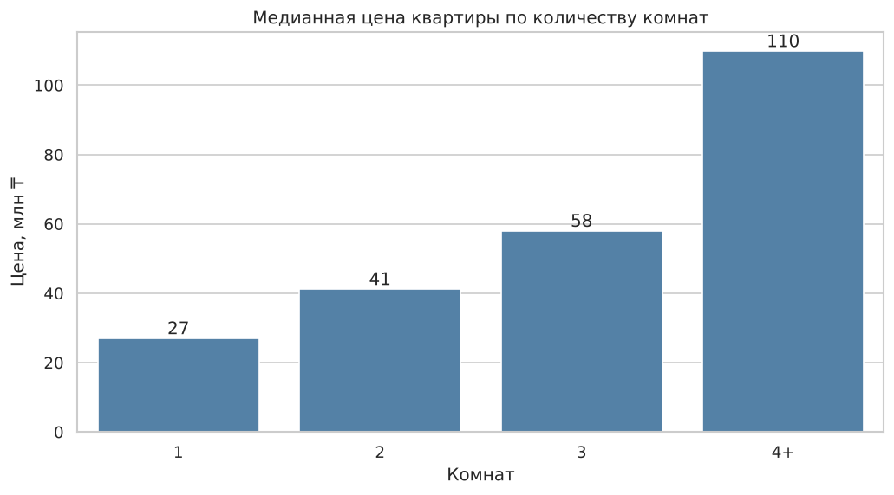
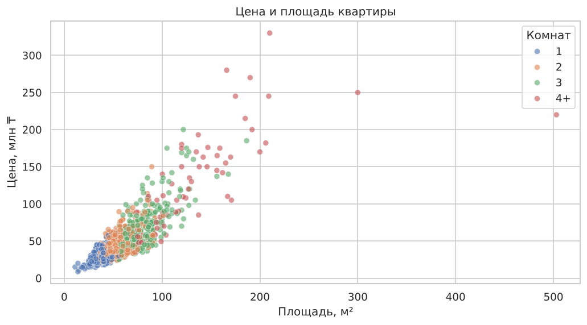
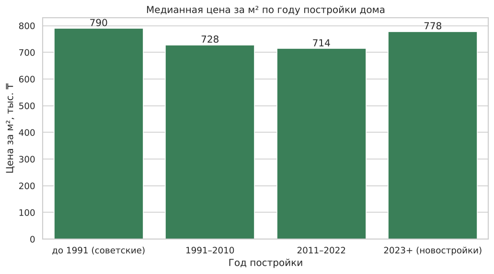
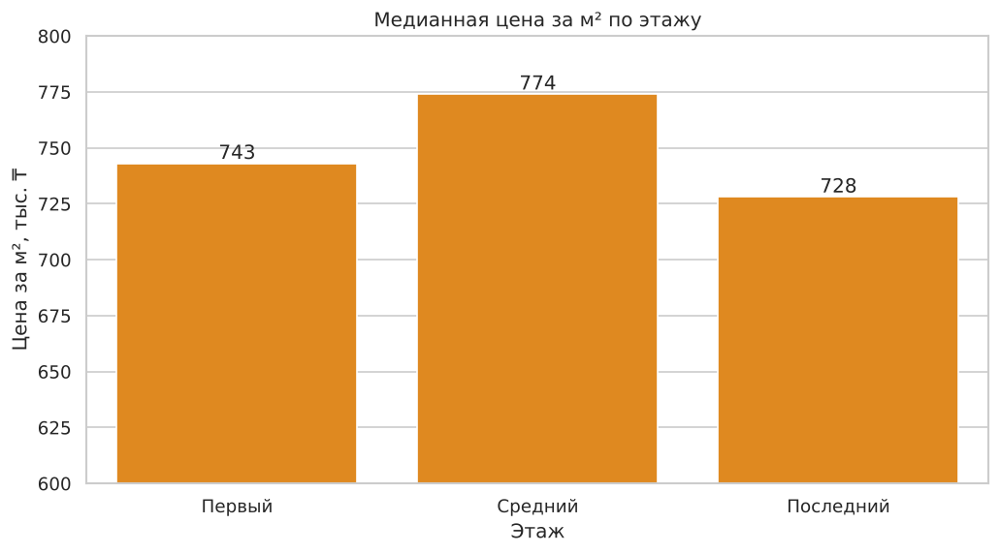
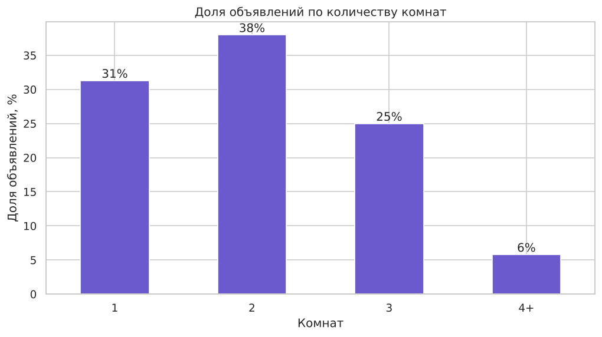

# Анализ рынка квартир Алматы

Исследование рынка продажи квартир в Алматы на данных, которые я **собрал сам**: парсер прошёл по 40 страницам объявлений на [kn.kz](https://www.kn.kz/almaty/prodazha-kvartir/) и собрал 1 200 квартир.

**Цель:** понять, сколько стоит квартира в Алматы и от чего зависит её цена.

**Стек:** Python · requests + BeautifulSoup (сбор данных) · pandas (очистка и анализ) · matplotlib, seaborn (графики) · scikit-learn (модель)

---

## Ключевые выводы

> Снимок рынка: ноябрь 2025. После очистки — 1 174 объявления.
> Везде используется медиана: она не искажается из-за нескольких очень дорогих квартир.

**1. Медианная квартира в Алматы стоит 40 млн ₸**, медианная цена — 764 тыс. ₸ за м².
Однокомнатная — 27 млн, двухкомнатная — 41 млн, трёхкомнатная — 58 млн, 4+ комнат — около 110 млн.



**2. Главный фактор цены — площадь** (корреляция 0,84). Этаж и год постройки на цену почти не влияют (0,14 и 0,09).



**3. Советские дома не дешевле новостроек**: 790 тыс. ₸ за м² против 778 тыс. Вероятно, решает расположение: старые дома стоят в центре, а новые часто строят на окраинах.



**4. Первый и последний этажи дешевле** средних: на 4% и 6% за м² соответственно.



**5. Рынок — это небольшие квартиры:** 1- и 2-комнатные дают 69% объявлений, а 39% предложения — новостройки 2023 года и новее.



## Модель оценки цены

Я сравнил две модели с простым ориентиром: «площадь × медианная цена за м²».

| Модель | Средняя ошибка, млн ₸ | Средняя ошибка, % |
|---|---|---|
| Ориентир: площадь × цена м² | 12,0 | 23,0 |
| Линейная регрессия | 11,9 | 24,8 |
| Случайный лес | 10,3 | 20,7 |

Лучшая модель почти не выигрывает у простой формулы. Причина в том, что в данных нет главного для цены: **района**, ремонта и класса дома. Чтобы точнее оценивать цену, нужна не более сложная модель, а более полные данные.

## Что сделано

1. **Сбор данных:** парсер на requests + BeautifulSoup собрал 1 200 объявлений: комнаты, площадь, цена, этаж, этажность, год постройки, адрес.
2. **Очистка:** удалены дубли и выбросы — 1% самых дешёвых и 1% самых дорогих объявлений по цене за м² (например, «3-комнатная квартира площадью 8 м²»).
3. **Новые признаки:** цена за м², группа по комнатам, возраст дома, тип этажа.
4. **Анализ:** пять вопросов о рынке, на каждый — график и вывод.
5. **Модель:** линейная регрессия и случайный лес в сравнении с простым ориентиром.

## Ограничения

- Одна площадка объявлений и снимок за один момент времени.
- Это цены в объявлениях, а не цены реальных сделок.
- В данных нет района, состояния квартиры и класса дома.

**Что можно улучшить:** собирать район и состояние квартиры, повторять сбор раз в месяц, чтобы видеть, как меняются цены.

## Структура проекта

```
almaty-housing-analysis/
├── almaty_housing_analysis.ipynb   # весь анализ: сбор, очистка, вопросы, модель, выводы
├── data/
│   └── almaty_housing_raw.csv      # собранные данные (1 200 объявлений)
├── images/                         # графики для README
└── requirements.txt                # нужные библиотеки
```

## Как запустить

```bash
pip install -r requirements.txt
jupyter notebook almaty_housing_analysis.ipynb
```

Ноутбук запускается сверху вниз на сохранённых данных. Чтобы собрать свежие объявления, в первой ячейке кода поставь `RUN_SCRAPER = True`.
